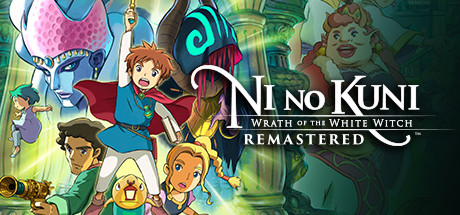

**Ni no Kuni: Wrath of the White Witch is a Studio Ghibli-adjacent JRPG with beautiful hand-drawn art, a heartfelt story about a boy traveling between worlds, and a monster-taming battle system. Features lush orchestral music by Joe Hisaishi.**

---

## 📖 About

Ni no Kuni: Wrath of the White Witch is a Studio Ghibli-adjacent JRPG with beautiful hand-drawn art, a heartfelt story about a boy traveling between worlds, and a monster-taming battle system. Features lush orchestral music by Joe Hisaishi.

## ⚠️ Problems Without Trainer

| Problem | Status |
|---------|--------|
| **AI Party Members** — Companions frequently waste turns using wrong skills | ✅ Solved |
| **Tame Rate RNG** — Catching rare familiars has extremely low success rates | ✅ Solved |
| **Alchemy Grind** — Best equipment requires specific item combinations and grinding | ✅ Solved |
| **Difficulty Spikes** — Mid-game boss difficulty increases sharply without warning | ✅ Solved |

## ✅ Solution

The **Ni no Kuni: Wrath of the White Witch Trainer** solves all these issues by giving you complete control over the game.

## 🎯 Full Feature List

- Unlimited Resources
- God Mode / Invincibility
- Instant Skill Cooldown
- One-Hit Kill
- Freeze Game Timer
- Unlock All Items & Achievements
- Custom Speed Multiplier
- Save State Anywhere

## 🚀 Quick Start

1. **Disable Windows Defender** temporarily (trainer may trigger false positive)
2. Download the trainer from the button above
3. Launch Ni no Kuni: Wrath of the White Witch
4. Run the trainer as Administrator
5. Activate desired cheats with hotkeys

## 💎 Free vs Paid

| Feature | Free | Pro |
|---------|------|-----|
| Basic God Mode | ✅ | ✅ |
| Unlimited Resources | ✅ | ✅ |
| All Advanced Cheats | ❌ | ✅ |
| Auto-Updates | ❌ | ✅ |
| Priority Support | ❌ | ✅ |

## 💻 Requirements

- Windows 10/11 (64-bit)
- Ni no Kuni: Wrath of the White Witch (any version)
- .NET Framework 4.8+
- DirectX 11+

## 🍎 macOS

macOS users can use our alternative tool:

## ⚖️ Legal

This trainer is for educational and single-player use only. Use responsibly.

---

